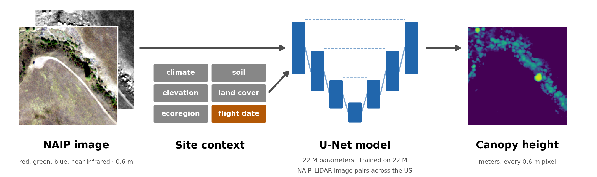
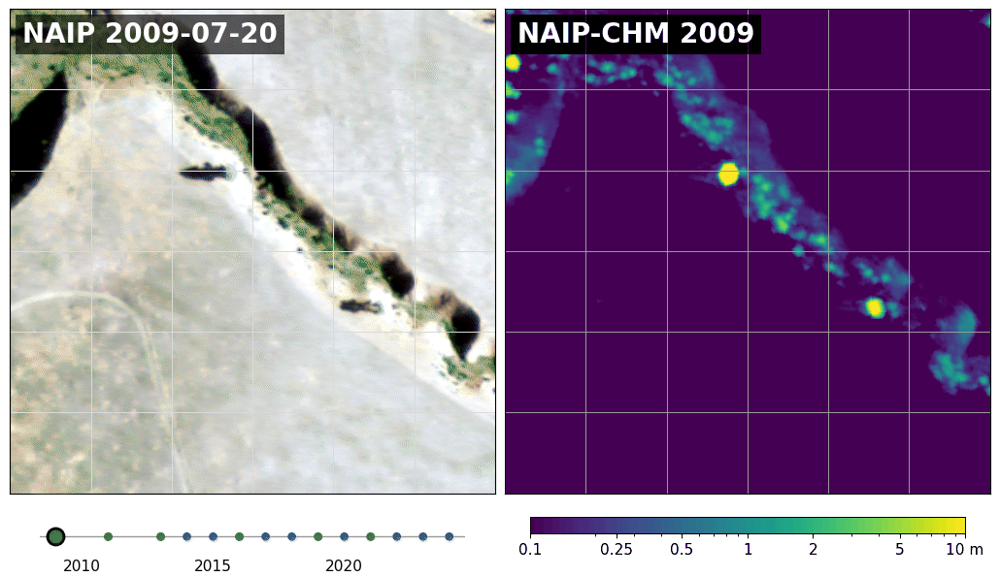
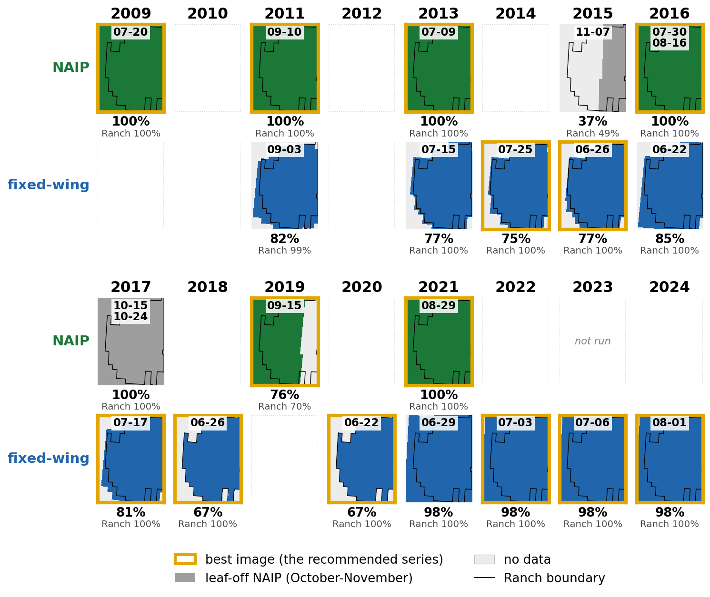
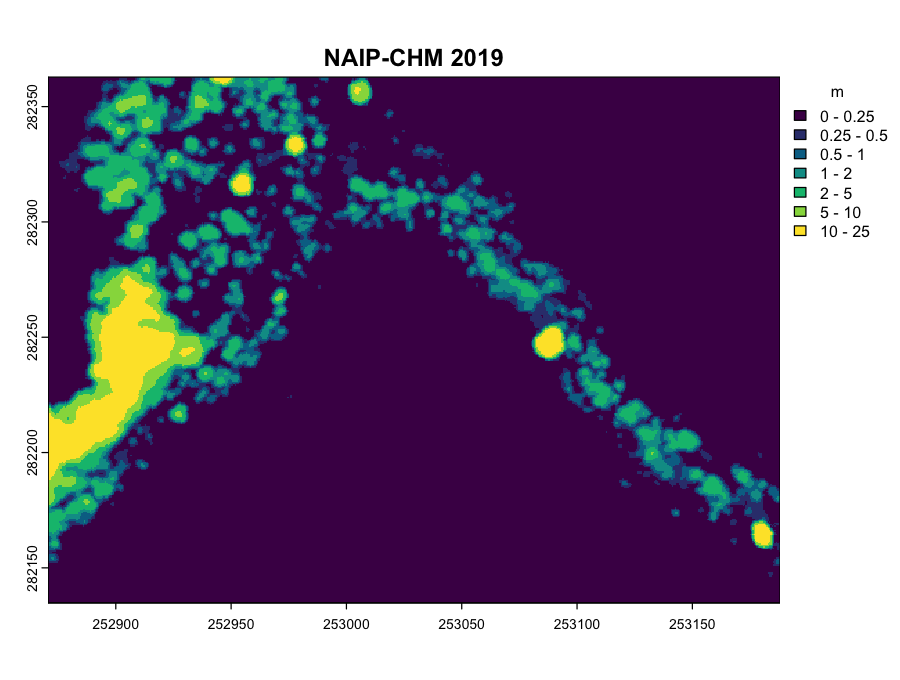
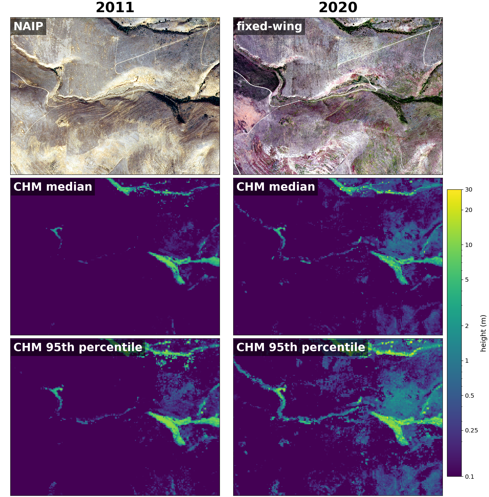

# MPG Ranch canopy height from NAIP and fixed-wing imagery




*The top panel shows how NAIP-CHM ([Morford et al. 2026](https://doi.org/10.1038/s41597-026-07549-w), [code](https://github.com/smorf-ntsg/naip-chm)) works. It reads a 4-band NAIP image together with site context (climate, soil, elevation, land cover, ecoregion and the flight's day of year) and predicts canopy height for every 0.6 m pixel. It was trained on over 22 million NAIP–LiDAR image pairs. The bottom panel is a predicted canopy height time series, 2009–2024, derived from NAIP and fixed-wing imagery at MPG Ranch.*

## Overview

This repository applies the published NAIP-CHM canopy height model ([Morford et al. 2026](https://doi.org/10.1038/s41597-026-07549-w), open access in *Scientific Data*, with code at [smorf-ntsg/naip-chm](https://github.com/smorf-ntsg/naip-chm)), unchanged, to imagery of MPG Ranch and the Bitterroot valley floor west of Baldy Mountain. Every product is a 0.6 m canopy height map.

- **Tested inputs.** 0.6 m NAIP (2017, 2019, 2021), the imagery the model was built for.
- **Untested inputs.** 1 m NAIP (2009–2016) and the Ranch's own fixed-wing surveys (0.15 m, 2011–2024). For these we check the outputs against Ranch LiDAR.
- **Leaf-off not recommended.** NAIP flown in October or November underestimates plant height, so those maps are flagged off-season and kept out of the recommended series.
- **One best map per year.** The recommended series uses in-season NAIP where it was flown and the fixed-wing survey otherwise, giving 14 years from 2009 to 2024.



*Where each NAIP and fixed-wing map has data, by year, with the flight's month-day. Gold frames mark each year's best image, and together they make the recommended series. Under each panel are the share of the map extent covered and the share of the Ranch. The fixed-wing surveys cover the whole Ranch every year, and only the land around it varies. Every image and LiDAR flight is in the [full acquisition timeline](docs/products.md#acquisition-timeline).*

Every file, its dates and coverage, the bands and the best-image rule are listed in [docs/products.md](docs/products.md) along with hyperlinks to the products.

## Quality assessment with LiDAR validation

The authors trained and tested NAIP-CHM on 0.6 m NAIP only, and their training code takes 256 m chips of 427 × 427 pixels. Two of our inputs fall outside that, so their accuracy figures don't carry over.

- **NAIP before 2017** was flown at 1 m here, coarser than anything the model learned from.
- **The Ranch's fixed-wing imagery** comes from a different camera, with its own color balance and much finer pixels.

We therefore checked every input against Ranch LiDAR in 1 m cells.

| LiDAR flown | Input data | Resolution | Input flown | Tested by the model authors | r² |
|---|---|---|---|---|---|
| 2016-09-01 | NAIP | 1 m | 2016-08-16 | no (coarser than the 0.6 m training imagery) | 0.82 |
| 2016-09-01 | Fixed-wing | 0.15 m | 2016-06-22 | no (Ranch camera, not NAIP) | 0.67 |
| 2020-05-09 / 06-02 | NAIP | 0.6 m | 2019-09-15 | yes | 0.78 |
| 2020-05-09 / 06-02 | Fixed-wing | 0.15 m | 2020-06-22 | no (Ranch camera, not NAIP) | 0.74 |
| 2021-10-16 | NAIP | 0.6 m | 2021-08-29 | yes | 0.70 |
| 2021-10-16 | Fixed-wing | 0.15 m | 2021-06-29 | no (Ranch camera, not NAIP) | 0.65 |

Fixed-wing imagery is averaged to 0.6 m before it goes into the model, and 1 m NAIP is resampled to 0.6 m by the model's own code.

- **The untested inputs hold up.** 1 m NAIP fits best of any row, and fixed-wing trails NAIP by 0.04–0.15 against the same LiDAR. Each LiDAR flight covers a different area, so compare rows only within a flight.
- **Short vegetation reads low from every input.** Heights come out at about half of LiDAR's from August NAIP, 40% from June fixed-wing and a quarter from October NAIP.

Details and figures are in [docs/validation.md](docs/validation.md).

## Load in R

```r
library(terra)
bucket_url <- "https://storage.googleapis.com/mpg-naip-chm/"

# The catalog lists every map, and best == TRUE marks the one best map per year
catalog   <- read.csv(paste0(bucket_url, "catalog.csv"))
best_maps <- catalog[catalog$best, ]

# Retrieve one year from the best-image series
map_2019 <- best_maps[best_maps$year == 2019, ]
map_2019$source; map_2019$acquired                                   # "naip", "2019-09-15"
chm_cm <- rast(paste0("/vsicurl/", bucket_url, map_2019$path))[[1]]  # band 1 is height in cm

# Helper that turns a lat/lon box (WGS84 degrees) into an extent in the products' CRS (EPSG:6514)
latlon_extent <- function(west, south, east, north, crs_to = "EPSG:6514") {
  box <- densify(vect(ext(west, east, south, north), crs = "EPSG:4326"), 10)
  ext(project(box, crs_to))
}

# Read only an area of interest and convert to meters
area_of_interest <- latlon_extent(-114.0439, 46.6985, -114.0399, 46.7004)  # or ext() in EPSG:6514 meters
height_m <- crop(chm_cm, area_of_interest) / 100
names(height_m) <- "height_m"
height_m

plot(height_m, breaks = c(0, 0.25, 0.5, 1, 2, 5, 10, 25), col = hcl.colors(7, "viridis"),
     main = "NAIP-CHM 2019", plg = list(title = "m"))
```

Output:

```
class       : SpatRaster 
size        : 380, 529, 1  (nrow, ncol, nlyr)
resolution  : 0.6, 0.6  (x, y)
extent      : 252870.6, 253188, 282134.8, 282362.8  (xmin, xmax, ymin, ymax)
coord. ref. : NAD83(2011) / Montana (EPSG:6514) 
source(s)   : memory
varname     : naip_chm_2019_20190915 
name        : height_m 
min value   :     0.00 
max value   :    21.17 
```



Files are cloud-optimized, so `crop` downloads only the area of interest. `latlon_extent()` returns the projected box's full extent, so the area is slightly larger than the lat/lon box. Python, GDAL and QGIS are covered in [docs/access.md](docs/access.md).

## Derived canopy metrics

```r
# Continues from "Load in R" (uses bucket_url and best_maps).

# Settings, the same values the published 10 m files use (scripts/08_derive.py)
cell_size_m     <- 10                                      # side of each summary cell (m)
min_valid_share <- 0.5                                     # a cell needs data in at least this share of its pixels
grid_origin     <- c(x = 252000, y = 286000)               # top-left corner of the products' grid (EPSG:6514 m),
                                                           #   which keeps cells aligned across years and with the files
upper_quantile  <- 0.95                                    # the upper height percentile reported
figure_area     <- ext(253700, 255700, 280700, 282200)     # area to summarize (EPSG:6514 m), the window in the figure below

# Summarize a 0.6 m canopy height map (cm) in square cells with any function of the heights (m).
# Each 0.6 m pixel counts toward the cell holding its center, and cells with data in less than min_valid_share
# of their pixels are left NA. summary_fun gets only pixels with data and returns one or more named values,
# and each becomes a layer.
summarize_cells <- function(chm_cm, area, summary_fun, cell_size, min_valid_share, grid_origin) {
  # the grid, snapped outward from the origin to cover the area
  snap  <- function(value, origin, round_fun) origin + cell_size * round_fun((value - origin) / cell_size)
  cells <- rast(ext(snap(xmin(area), grid_origin[["x"]], floor), snap(xmax(area), grid_origin[["x"]], ceiling),
                    snap(ymin(area), grid_origin[["y"]], floor), snap(ymax(area), grid_origin[["y"]], ceiling)),
                resolution = cell_size, crs = crs(chm_cm))

  pixels        <- crop(chm_cm, cells, snap = "out")
  height_m      <- values(pixels, mat = FALSE) / 100
  cell_of_pixel <- cellFromXY(cells, xyFromCell(pixels, seq_len(ncell(pixels))))
  in_area       <- !is.na(cell_of_pixel)
  has_height    <- in_area & !is.na(height_m)

  heights_by_cell <- split(height_m[has_height],
                           factor(cell_of_pixel[has_height], levels = seq_len(ncell(cells))))
  example <- summary_fun(heights_by_cell[[which(lengths(heights_by_cell) > 0)[1]]])
  n_stats <- length(example)
  stats <- vapply(heights_by_cell,
                  \(h) if (length(h)) as.numeric(summary_fun(h)) else rep(NA_real_, n_stats),
                  numeric(n_stats))
  stats <- matrix(stats, ncol = n_stats, byrow = TRUE)                  # one row per cell

  pixels_per_cell <- tabulate(cell_of_pixel[in_area], ncell(cells))
  valid_per_cell  <- tabulate(cell_of_pixel[has_height], ncell(cells))
  stats[valid_per_cell < min_valid_share * pixels_per_cell, ] <- NA

  layer_names <- if (is.null(names(example))) paste0("stat_", seq_len(n_stats)) else names(example)
  summary_map <- rast(cells, nlyrs = n_stats, names = layer_names)
  values(summary_map) <- stats
  summary_map
}

load_best_map <- function(year) rast(paste0("/vsicurl/", bucket_url, best_maps$path[best_maps$year == year]))[[1]]
summarize     <- function(year, summary_fun) {
  summarize_cells(load_best_map(year), figure_area, summary_fun,
                  cell_size = cell_size_m, min_valid_share = min_valid_share, grid_origin = grid_origin)
}
height_stats  <- function(h) {                             # zeros (bare ground) included
  setNames(c(median(h), quantile(h, upper_quantile, names = FALSE)),
           c("median_m", sprintf("p%g_m", 100 * upper_quantile)))                 # layers median_m, p95_m
}

summaries <- lapply(c("2011" = 2011, "2020" = 2020), summarize, summary_fun = height_stats)
plot(summaries[["2020"]], breaks = c(0, 0.25, 0.5, 1, 2, 5, 10, 35), col = hcl.colors(7, "viridis"))

# Any function of the heights works, for example the share of each cell at least 2 m tall
cover_2020 <- summarize(2020, \(h) c(cover_ge_2m = mean(h >= 2)))
```

Each best-series map is summarized in 10 m cells. The published files (made by `scripts/08_derive.py`) use the settings at the top of the chunk.

- **Cell size.** 10 m, on one grid for every year, anchored at the products' top-left corner (x 252,000, y 286,000 in EPSG:6514), which gives 600 × 791 cells over the extent.
- **Pixels per cell.** Each 0.6 m pixel counts toward the cell holding its center. 10 m isn't a whole number of 0.6 m pixels, so a cell holds 16 or 17 pixels per side (256–289 pixels).
- **Minimum coverage.** A cell with data in less than half of its pixels is left empty.
- **Statistics.** The median and 95th percentile of every pixel with data, zero heights included. Files store whole centimeters (uint16, nodata 65535), with the median in band 1 and the 95th percentile in band 2.

So far 2011 and 2020 are made, and the rest of the series is *(planned)*. The files are in `derived/` in the bucket. The chunk rebuilds them from the 0.6 m maps for any area, matching the files to within their 1 cm rounding. Change `cell_size_m` or `upper_quantile` for other summaries, or pass any function of the heights, such as the share of each cell at least 2 m tall.



*One column per year. Rows show the best image's true color as the model saw it, then the CHM median and 95th percentile in 10 m cells. 2011 comes from 1 m NAIP flown 2011-09-10, and 2020 from fixed-wing imagery flown 2020-06-22. The window is 2 × 1.5 km of draws (EPSG:6514 x 253,700–255,700, y 280,700–282,200), imaged in both years. The 2011 file covers the full extent, and the 2020 file covers the 67% the 2020 survey imaged. The two years come from different sources, so part of the difference between them is the source, not vegetation change.*

## More

- [docs/products.md](docs/products.md) lists every file with download links, its dates and coverage, the bands, the catalog columns and the best-image rule.
- [docs/access.md](docs/access.md) covers Python, GDAL, QGIS and whole-file downloads.
- [docs/validation.md](docs/validation.md) gives the LiDAR checks in full.
- [docs/methods.md](docs/methods.md) explains how the model was run and how to reproduce the products.

**License.** The code is MIT ([LICENSE](LICENSE)). The maps, catalog and figures are CC BY 4.0 ([LICENSE-DATA.md](LICENSE-DATA.md)), so please credit MPG Ranch, for example as *MPG Ranch (2026). Canopy height maps of MPG Ranch from NAIP and fixed-wing imagery, 2009–2024. https://github.com/mosscoder/mpg-naip-chm*.

Please also cite the model paper and its code when using these products.

- Morford, S. L., Allred, B. W., Coons, S. P., Marcozzi, A. A., McCord, S. E., Smith, J. T. & Naugle, D. E. (2026). A 0.6-meter resolution canopy height model for the contiguous United States. *Scientific Data* 13, 1207. https://doi.org/10.1038/s41597-026-07549-w (open access, CC BY 4.0)
- Morford, S. (2025). NAIP-CHM: A 0.6-meter resolution canopy height and structure model for the contiguous United States (v1.0.0) [code and model weights]. Zenodo. https://doi.org/10.5281/zenodo.17664995. Development repository at https://github.com/smorf-ntsg/naip-chm (MIT license).
