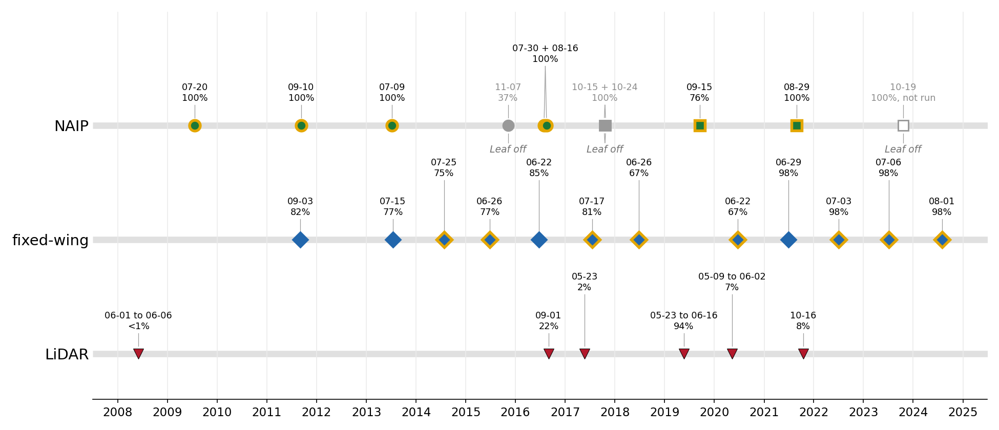

# Products

[← README](../README.md)

**Bucket:** `gs://mpg-naip-chm/` (public, read-only; us-central1). License: CC BY 4.0 ([LICENSE-DATA.md](../LICENSE-DATA.md)).
**HTTPS:** `https://storage.googleapis.com/mpg-naip-chm/<path>`

**To download a map, click its file name** in the tables below; most are 100–150 MB. Each file is a GeoTIFF that
opens in [QGIS](https://qgis.org) (free) or ArcGIS. Band 1 is canopy height in centimeters (divide by 100 for meters);
band 2 is the day of year the imagery was flown. For one map per year, use the
[best-image series](#best-image-series). Other ways in, including R, Python and reading just an area: [access.md](access.md).

## Acquisition timeline

*Every image and LiDAR flight over the map extent, labeled with its month-day and the share of the extent it covers. NAIP circles are 1 m and squares 0.6 m; fixed-wing flights are diamonds and LiDAR flights triangles. Gray marks leaf-off NAIP, and the hollow 2023 square wasn't run. A gold outline marks the best image for each year. The data are in `catalog/acquisitions.csv`.*

## Format

| Property | Value |
|---|---|
| Extent | x 252,000–258,000, y 278,099–286,000 m (47.4 km², 31.9 km² of it on the Ranch) |
| CRS | EPSG:6514, NAD83(2011) Montana State Plane, meters |
| Pixel | 0.6 m; every product is on the same grid |
| Band 1 | canopy height, uint16 centimeters; nodata 65535 |
| Band 2 | acquisition day of year for each pixel |
| Tags | `ACQUISITION_DATE(S)`, `SOURCE`, `SOURCE_GSD_M`, `MODEL` |
| Format | cloud-optimized GeoTIFF, deflate, internal overviews |

## NAIP series (`naip/`)

| File | NAIP acquired | Input | Season | Coverage | Size |
|---|---|---|---|---|---|
| [`naip_chm_2009_20090720.tif`](https://storage.googleapis.com/mpg-naip-chm/naip/naip_chm_2009_20090720.tif) | 2009-07-20 | 1 m, untested | in | 100% | 124 MB |
| [`naip_chm_2011_20110910.tif`](https://storage.googleapis.com/mpg-naip-chm/naip/naip_chm_2011_20110910.tif) | 2011-09-10 | 1 m, untested | in | 100% | 124 MB |
| [`naip_chm_2013_20130709.tif`](https://storage.googleapis.com/mpg-naip-chm/naip/naip_chm_2013_20130709.tif) | 2013-07-09 | 1 m, untested | in | 100% | 129 MB |
| [`naip_chm_2015_20151107.tif`](https://storage.googleapis.com/mpg-naip-chm/naip/naip_chm_2015_20151107.tif) | 2015-11-07 | 1 m, untested | **off** | 37% (east) | 59 MB |
| [`naip_chm_2016_20160730-20160816.tif`](https://storage.googleapis.com/mpg-naip-chm/naip/naip_chm_2016_20160730-20160816.tif) | 2016-07-30 (east) / 08-16 (west) | 1 m, untested | in | 100% | 143 MB |
| [`naip_chm_2017_20171015-20171024.tif`](https://storage.googleapis.com/mpg-naip-chm/naip/naip_chm_2017_20171015-20171024.tif) | 2017-10-15 (west) / 10-24 (east) | 0.6 m, tested | **off** | 100% | 145 MB |
| [`naip_chm_2019_20190915.tif`](https://storage.googleapis.com/mpg-naip-chm/naip/naip_chm_2019_20190915.tif) | 2019-09-15 | 0.6 m, tested | in | 76% (west) | 106 MB |
| [`naip_chm_2021_20210829.tif`](https://storage.googleapis.com/mpg-naip-chm/naip/naip_chm_2021_20210829.tif) | 2021-08-29 | 0.6 m, tested | in | 100% | 151 MB |

- Montana has no 4-band NAIP for 2008, 2010, 2012, 2014, 2018 or 2020.
- 2009 was read from Earth Engine; later years come from Planetary Computer.
- The model resamples 1 m NAIP to 0.6 m itself (bilinear).
- The 2011 map reads low in tall trees.
- For 2023, the authors' official CONUS product covers the Ranch (NAIP flown 2023-10-19, off-season). It wasn't rerun here.

## Fixed-wing series (`fixed_wing/`)

| File | Flown | Coverage | Size |
|---|---|---|---|
| [`fixedwing_chm_2011_20110903.tif`](https://storage.googleapis.com/mpg-naip-chm/fixed_wing/fixedwing_chm_2011_20110903.tif) | 2011-09-03 | 82% | 113 MB |
| [`fixedwing_chm_2013_20130715.tif`](https://storage.googleapis.com/mpg-naip-chm/fixed_wing/fixedwing_chm_2013_20130715.tif) | 2013-07-15 | 77% | 105 MB |
| [`fixedwing_chm_2014_20140725.tif`](https://storage.googleapis.com/mpg-naip-chm/fixed_wing/fixedwing_chm_2014_20140725.tif) | 2014-07-25 | 75% | 100 MB |
| [`fixedwing_chm_2015_20150626.tif`](https://storage.googleapis.com/mpg-naip-chm/fixed_wing/fixedwing_chm_2015_20150626.tif) | 2015-06-26 | 77% | 104 MB |
| [`fixedwing_chm_2016_20160622.tif`](https://storage.googleapis.com/mpg-naip-chm/fixed_wing/fixedwing_chm_2016_20160622.tif) | 2016-06-22 | 85% | 121 MB |
| [`fixedwing_chm_2017_20170717.tif`](https://storage.googleapis.com/mpg-naip-chm/fixed_wing/fixedwing_chm_2017_20170717.tif) | 2017-07-17 | 81% | 110 MB |
| [`fixedwing_chm_2018_20180626.tif`](https://storage.googleapis.com/mpg-naip-chm/fixed_wing/fixedwing_chm_2018_20180626.tif) | 2018-06-26 | 67% | 97 MB |
| [`fixedwing_chm_2020_20200622.tif`](https://storage.googleapis.com/mpg-naip-chm/fixed_wing/fixedwing_chm_2020_20200622.tif) | 2020-06-22 | 67% | 99 MB |
| [`fixedwing_chm_2021_20210629.tif`](https://storage.googleapis.com/mpg-naip-chm/fixed_wing/fixedwing_chm_2021_20210629.tif) | 2021-06-29 | 98% | 145 MB |
| [`fixedwing_chm_2022_20220703.tif`](https://storage.googleapis.com/mpg-naip-chm/fixed_wing/fixedwing_chm_2022_20220703.tif) | 2022-07-03 | 98% | 149 MB |
| [`fixedwing_chm_2023_20230706.tif`](https://storage.googleapis.com/mpg-naip-chm/fixed_wing/fixedwing_chm_2023_20230706.tif) | 2023-07-06 | 98% | 150 MB |
| [`fixedwing_chm_2024_20240801.tif`](https://storage.googleapis.com/mpg-naip-chm/fixed_wing/fixedwing_chm_2024_20240801.tif) | 2024-08-01 | 98% | 144 MB |

The source imagery is the Ranch's 4-band mosaics, `gs://mpg-aerial-survey/surveys/fixed_wing/cogs/clean/{year}_4band.tif` (0.152 m), area-averaged to 0.6 m. There was no survey in 2012 or 2019. Every flight falls between June and September. The 2018 and 2020 surveys share one footprint but are different imagery.

## Best-image series

**Rule:** for each year, use NAIP if it was flown in season (June–September); otherwise use that year's fixed-wing survey. October and November NAIP are off-season.

| Year | Best map | Why |
|---|---|---|
| 2009 | [NAIP 2009-07-20](https://storage.googleapis.com/mpg-naip-chm/naip/naip_chm_2009_20090720.tif) | |
| 2011 | [NAIP 2011-09-10](https://storage.googleapis.com/mpg-naip-chm/naip/naip_chm_2011_20110910.tif) | |
| 2013 | [NAIP 2013-07-09](https://storage.googleapis.com/mpg-naip-chm/naip/naip_chm_2013_20130709.tif) | |
| 2014 | [fixed-wing 2014-07-25](https://storage.googleapis.com/mpg-naip-chm/fixed_wing/fixedwing_chm_2014_20140725.tif) | no NAIP |
| 2015 | [fixed-wing 2015-06-26](https://storage.googleapis.com/mpg-naip-chm/fixed_wing/fixedwing_chm_2015_20150626.tif) | NAIP off-season (2015-11-07) |
| 2016 | [NAIP 2016-07-30 / 08-16](https://storage.googleapis.com/mpg-naip-chm/naip/naip_chm_2016_20160730-20160816.tif) | |
| 2017 | [fixed-wing 2017-07-17](https://storage.googleapis.com/mpg-naip-chm/fixed_wing/fixedwing_chm_2017_20170717.tif) | NAIP off-season (2017-10-15 / 10-24) |
| 2018 | [fixed-wing 2018-06-26](https://storage.googleapis.com/mpg-naip-chm/fixed_wing/fixedwing_chm_2018_20180626.tif) | no NAIP |
| 2019 | [NAIP 2019-09-15](https://storage.googleapis.com/mpg-naip-chm/naip/naip_chm_2019_20190915.tif) | no fixed-wing; west 76% only |
| 2020 | [fixed-wing 2020-06-22](https://storage.googleapis.com/mpg-naip-chm/fixed_wing/fixedwing_chm_2020_20200622.tif) | no NAIP |
| 2021 | [NAIP 2021-08-29](https://storage.googleapis.com/mpg-naip-chm/naip/naip_chm_2021_20210829.tif) | |
| 2022 | [fixed-wing 2022-07-03](https://storage.googleapis.com/mpg-naip-chm/fixed_wing/fixedwing_chm_2022_20220703.tif) | no NAIP |
| 2023 | [fixed-wing 2023-07-06](https://storage.googleapis.com/mpg-naip-chm/fixed_wing/fixedwing_chm_2023_20230706.tif) | NAIP off-season (2023-10-19) |
| 2024 | [fixed-wing 2024-08-01](https://storage.googleapis.com/mpg-naip-chm/fixed_wing/fixedwing_chm_2024_20240801.tif) | NAIP not processed |

There is no imagery for 2010 or 2012. In fixed-wing years the map covers only that survey's footprint (67–98% of the extent).

**Mixing sources.** The series switches between NAIP and fixed-wing, and the two read differently: fixed-wing read lower than NAIP in tall conifers in 2021, and its radiometry changes from year to year (see [validation.md](validation.md)). Check that a trend isn't just a switch between sources, for example by comparing both sources in years that have both (2011, 2013, 2016, 2021).

## Derived 10 m maps (`derived/`)

Median and 95th percentile canopy height of the best map in 10 m cells (band 1 median, band 2 95th percentile, both
uint16 centimeters; nodata 65535). See the README's derived-products section for how they're made.

| File | From | Size |
|---|---|---|
| [`naip_chm_2011_20110910_10m.tif`](https://storage.googleapis.com/mpg-naip-chm/derived/naip_chm_2011_20110910_10m.tif) | NAIP 2011-09-10 | 1.2 MB |
| [`fixedwing_chm_2020_20200622_10m.tif`](https://storage.googleapis.com/mpg-naip-chm/derived/fixedwing_chm_2020_20200622_10m.tif) | fixed-wing 2020-06-22 | 0.9 MB |

The other best-series years are *(planned)*.

## Catalog (`catalog.csv`)

One row per 0.6 m map (20 rows; the derived 10 m files are listed above), with these columns. A copy is in the repo at `catalog/catalog.csv`.

| Column | Meaning |
|---|---|
| `year` | imagery year |
| `source` | `naip` or `fixed_wing` |
| `acquired` | acquisition date(s), YYYY-MM-DD; two dates joined by `/` |
| `input` | `tested` (0.6 m NAIP) or `untested` (1 m NAIP, fixed-wing) |
| `season` | `in` (June–September) or `off` |
| `best` | `TRUE` for the year's best-image map |
| `coverage_pct` | share of the extent with data |
| `path` | path in the bucket |
| `bytes`, `md5` | file size and checksum |
